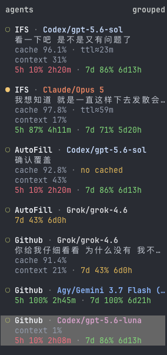
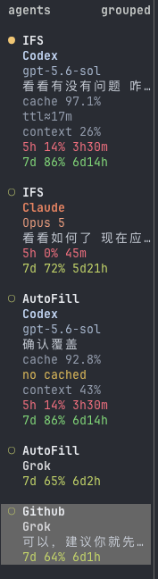
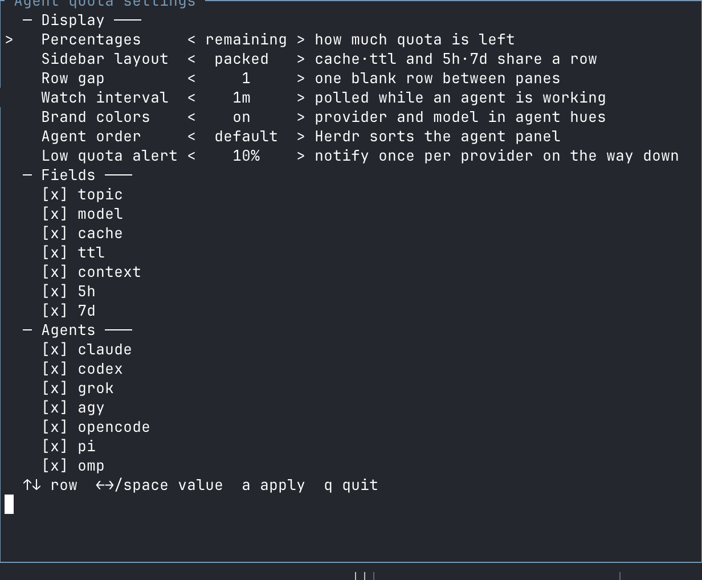

# herdr-agent-quota

Credential-scoped model, context, cache, and quota data in Herdr's Agent sidebar.

[](https://github.com/sunholo-data/herdr-agent-quota/actions/workflows/ci.yml)
[](https://www.rust-lang.org/)
[](LICENSE)

> **Maintained fork.** This is a continuation of
> [`levi-qiao/herdr-agent-quota`](https://github.com/levi-qiao/herdr-agent-quota) by Levi Qiao,
> imported unchanged from upstream release 1.3.0 (commit `3b63f83`) after the original
> repository and account stopped being available on GitHub. All credit for the plugin goes
> to the original author; the MIT license and copyright notice are kept as-is.
>
> Install with `herdr plugin install sunholo-data/herdr-agent-quota`.

中文文档：[README.zh-CN.md](README.zh-CN.md)

<table>
<tr><th>packed (default)</th><th>stacked</th></tr>
<tr>
<td valign="top"></td>
<td valign="top"></td>
</tr>
</table>

Empty values collapse. Failed refreshes keep the last good value for the same
account; confirmed PAYG sessions clear stale subscription quota.

## Install

Requires Herdr 0.8.0+, Rust 1.95+, macOS or Linux, and at least one supported agent CLI.

### From GitHub (recommended)

```sh
herdr plugin install sunholo-data/herdr-agent-quota
herdr plugin action invoke configure --plugin herdr-agent-quota
```

Herdr clones the repository and builds it with `cargo build --release`; the
`configure` action then adds the sidebar rows and agent hooks (including the
Claude Code `statusLine`). Restart already-running agent panes once.

To update, reinstall (Herdr 0.8 has no in-place plugin update; settings in the
plugin config directory are kept):

```sh
herdr plugin uninstall herdr-agent-quota
herdr plugin install sunholo-data/herdr-agent-quota
herdr plugin action invoke configure --plugin herdr-agent-quota
```

### From a local clone

Use this to pick a subset of agents or set options at install time:

```sh
git clone https://github.com/sunholo-data/herdr-agent-quota.git
cd herdr-agent-quota
./install.sh                          # or: ./install.sh --agent claude,codex,omp
```

`install.sh` builds the clone, links it with `herdr plugin link`, and runs
`configure`; update by `git pull` and re-running it. Supported `--agent`
values: `all`, `claude`, `codex`, `grok`, `agy`, `opencode`, `pi`, `omp`.
Run `./install.sh --help` for the other options.

### Moving from `levi-qiao/herdr-agent-quota`

The upstream repository is gone, so an existing install can no longer be
refreshed from it. Run the reinstall steps above to switch it over; your
settings in the plugin config directory are kept.

## Settings

Press `prefix+shift+q`, or run:

```sh
herdr plugin pane open --plugin herdr-agent-quota --entrypoint settings --focus
```

Herdr 0.8 does not expose extension points for its built-in Settings tabs or
bottom-right menu. The plugin therefore opens its own managed popup. A key
conflict is preserved rather than overwritten; use the command above instead.



| Control | Values | Effect |
| --- | --- | --- |
| Percentages | `remaining`, `used` | Changes the number; colors still mean remaining headroom. |
| Sidebar layout | `packed`, `stacked` | Joins related fields or gives each field a row. |
| Row gap | `0`, `1` | Controls spacing between Agent cards. |
| Watch interval | 30s–1h | Refresh cadence while an agent is working. |
| Brand colors | `on`, `off` | Colors provider/model names; severity colors remain. |
| Agent order | `default`, `quota` | Optionally puts the lowest-headroom agent first. |
| Low quota alert | `off`, 5–50% | Notifies once when a provider crosses the threshold. |
| Fields | topic, model, cache, TTL, context, short/long quota | Hides optional dimensions. |
| Agents | seven supported harnesses | Installs or removes collectors and sidebar rows. |

Use `↑/↓` to move, `←/→` or Space to change, `a` to apply, and `q` to close.
A `*` means there are unapplied changes.

The same settings are scriptable:

```sh
./install.sh \
  --agent all \
  --sidebar-layout packed \
  --row-gap 1 \
  --quota-percent remaining \
  --fields all \
  --brand-colors on \
  --agent-order quota \
  --low-quota-alert 10 \
  --watch-interval-seconds 60
```

Manual refresh and uninstall:

```sh
herdr plugin action invoke refresh --plugin herdr-agent-quota
./uninstall.sh
```

## What is displayed

| Dimension | Source and behavior |
| --- | --- |
| Provider / model | Exact route and active model for the pane's session. |
| Topic | Current visible user prompt; the previous topic survives when it scrolls away. |
| Context | Used percentage of the active model's context window. |
| Cache | Session cache hit rate when the agent exposes trustworthy counters. |
| Cache TTL | Recorded expiry when available; `ttl≈` marks a documented estimate. |
| Quota | Remaining or used percentage plus reset ETA, scoped to the serving account. |
| Headroom | Tightest visible quota, used by optional sorting and notifications. |

| Agent | Quota support | Session diagnostics |
| --- | --- | --- |
| Claude Code | 5h + 7d | model, context, cache, recorded prompt-cache expiry |
| OpenAI Codex | 5h + 7d | model, context, cache, estimated 30m cache TTL, summary |
| Grok CLI | 7d or 30d | model, context, cache |
| Agy / Antigravity | 5h + 7d | statusLine model, context, cache |
| OpenCode | OpenCode Go 5h + 7d; 30d in dashboard | exact local session model/context |
| Pi | Canonical Codex quota on an exact account match | model, context, cache, supported TTL data |
| omp (oh-my-pi) | OMP-normalized windows such as `5h`, `1d`, `7d`, `Monthly` | model, context, cache, supported TTL data |

OMP is a generic adapter, not a second set of provider adapters. The plugin runs
`omp usage --json --provider <id>`, retains OMP's window labels, and attributes
the result with the session's `credential_pin`. It never opens OMP's credential
database or reinterprets Google, Anthropic, or OpenAI periods. OMP's five-minute
usage cache remains authoritative; this plugin adds a one-minute process debounce.

The sidebar has short and long quota rows. OMP's common windows occupy those rows
while retaining their labels; one normalized window is shown per row.

## Herdr integrations

Herdr must report the exact session before local model, context, and account data
can be attributed:

```sh
herdr integration status
```

Enabling OMP automatically installs `herdr integration omp` when it is missing.
Restart an already-running OMP pane afterward because integrations load at agent
startup. Other missing integrations can be repaired directly:

```sh
herdr integration install opencode
herdr integration install pi
herdr integration install omp
```

## Troubleshooting

| Symptom | Check |
| --- | --- |
| OpenCode, Pi, or OMP is blank | Run `herdr integration status`, install the missing integration, then restart that pane. |
| OMP has model/context but no quota | Run `omp usage --json --redact --provider <id>` and confirm a report exists. |
| Herdr cannot execute OMP | Put `omp` on the server's `PATH`, or set `HERDR_AGENT_QUOTA_OMP_BIN`. |
| Claude or Agy shows `N/A` | Send one turn so its statusLine emits a snapshot. |
| Rows do not appear | Run `herdr plugin action invoke configure --plugin herdr-agent-quota`, then restart affected panes. |
| A value survives a provider outage | Expected: the same account's last good snapshot is retained. |
| Packed rows are truncated | Switch to `stacked`; Herdr does not wrap sidebar tokens. |

## Safety

- No prompt or model request is generated.
- Events read only their named pane with `--source visible`; refresh and watch do not read panes.
- Credentials remain in the owning CLI. Snapshots hold sanitized usage and hashed attribution only.
- OMP's `agent.db` is never opened; quota comes only from OMP CLI output.
- Metadata is written only when a token changes and remains within Herdr's 16-token limit.

## Development

```sh
cargo fmt --all -- --check
cargo test --all-targets --all-features --locked
cargo clippy --release --all-targets --all-features --locked -- -D warnings
cargo build --release --locked
```

See [CONTRIBUTING.md](CONTRIBUTING.md), [SECURITY.md](SECURITY.md), and
[CHANGELOG.md](CHANGELOG.md).

## License

MIT. Not affiliated with Herdr, OpenAI, Anthropic, xAI, Google, or OpenCode.
